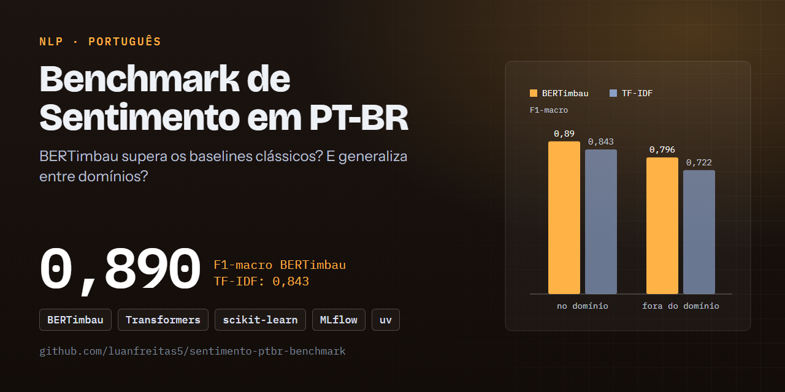
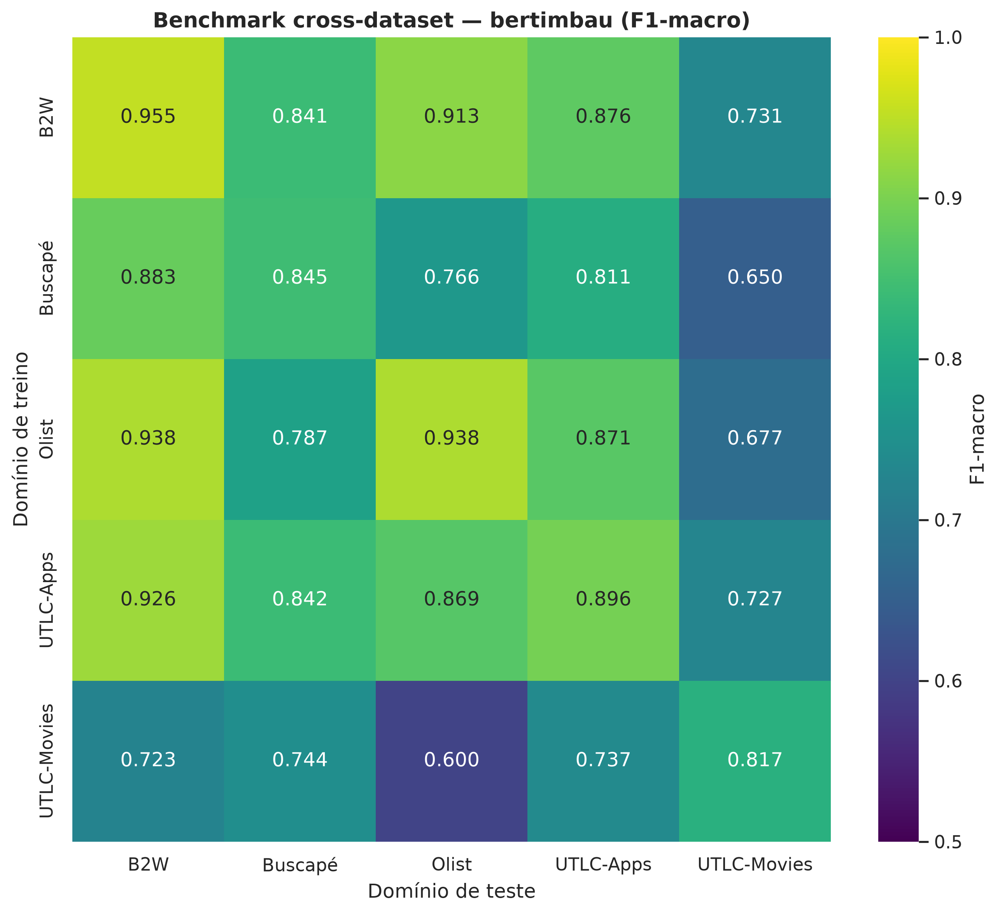
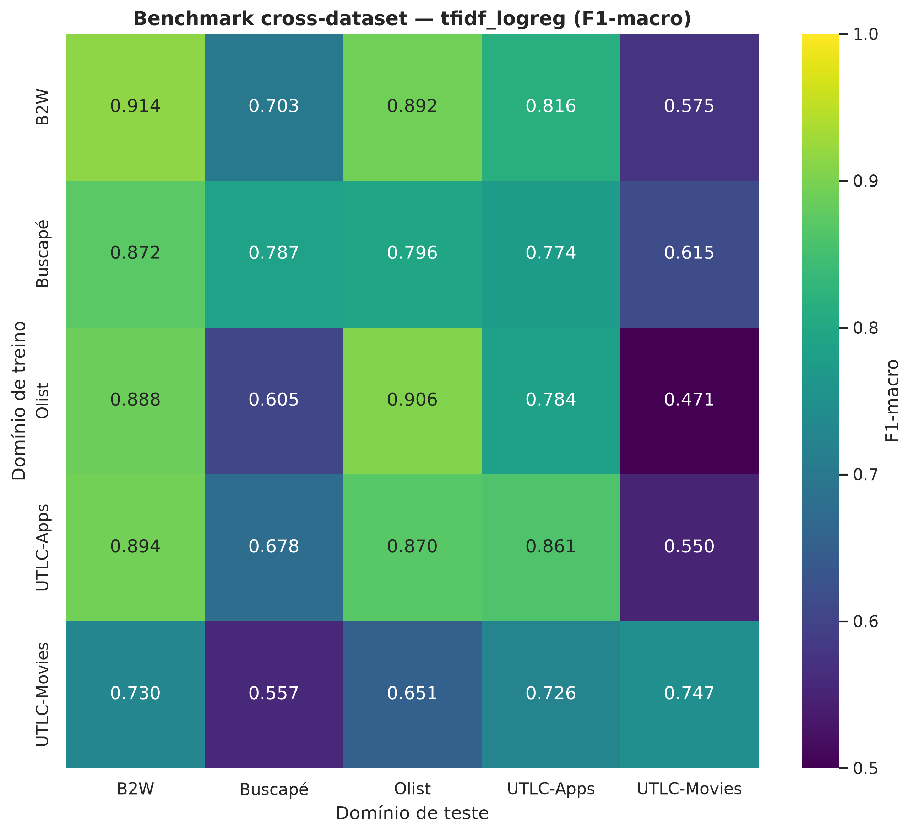

# Benchmark de Análise de Sentimento em PT-BR: BERTimbau eleva o F1-macro de sentimento em PT-BR de 0,843 para 0,890 — e reduz a perda fora do domínio

[](https://github.com/luanfreitas5/sentimento-ptbr-benchmark/actions/workflows/ci.yml)
[](https://codecov.io/gh/luanfreitas5/sentimento-ptbr-benchmark)
[](https://luanfreitas5.github.io/sentimento-ptbr-benchmark/)
[](LICENSE)
 <!-- = matriz do CI (tests.yml) -->

> **Resultado:** o BERTimbau fine-tuned atinge F1-macro in-domain médio = **0,890** contra **0,843** do baseline TF-IDF + Regressão Logística (5 corpora de ~4.000 reviews de teste cada; IC 95% por bootstrap em cada domínio, tabela abaixo). Fora do domínio a média cai para **0,796** (BERTimbau) e **0,722** (baseline): o gap de generalização é de 0,095 vs. 0,121. Ou seja, o transformer compensa o custo, mas **nenhum dos dois modelos é confiável em filmes quando treinado em outro domínio**.



## 🎯 Problema

- **Quem decide o quê:** pesquisadores/engenheiros de NLP escolhem entre um baseline barato (CPU, segundos) e um fine-tuning de BERT (GPU, minutos) para classificar a polaridade de avaliações em português brasileiro, e precisam saber se o modelo treinado em um domínio serve em outro.
- **Custo dos erros:** os corpora são dominados pela classe positiva (67–90% no teste); errar a classe negativa é o erro caro para quem monitora reputação → **métrica principal:** F1-macro, porque a acurácia premia o modelo que só prevê "positivo".
- **Unidade de predição:** uma avaliação textual por linha → polaridade binária (0 = negativo, 1 = positivo). Não há dimensão temporal: split estratificado aleatório por domínio.

## 🗂️ Dados

| Item | Valor |
|---|---|
| Fonte e licença | [Kaggle — ptbr-sentiment-analysis-datasets](https://www.kaggle.com/datasets/fredericods/ptbr-sentiment-analysis-datasets) — licença de cada corpus: ver a página do Kaggle (não redistribuímos os dados) |
| Tamanho | 5 domínios (`b2w`, `buscape`, `olist`, `utlc_apps`, `utlc_movies`); amostra estratificada de 20.000 por domínio → ~16.000 treino / 4.000 teste ([`data/gold/manifest.json`](data/README.md)) |
| Período | 2026 |
| Alvo e prevalência (teste) | `polarity`; positivos: b2w 69,7% · buscape 90,1% · olist 66,6% · utlc_apps 71,7% · utlc_movies 88,3% |
| Camadas | `data/bronze` (CSV como recebido) → `data/silver` (limpo, validado) → `data/gold` (splits) — ver [`data/README.md`](data/README.md) |
| Documentação | [Datasheet](reports/datasheets/ptbr_sentiment_datasets.md) |

## 📊 Resultados

Protocolo: amostra estratificada de 20.000 por domínio, split 80/20 estratificado, seed 42; IC 95% por **bootstrap (1.000 reamostragens) no conjunto de teste** de cada domínio. Matriz cross-dataset: treina em cada domínio e testa em todos (5 × 5). Fonte dos números: [`benchmark_tfidf_logreg.json`](reports/metrics/benchmark_tfidf_logreg.json), [`benchmark_bertimbau.json`](reports/metrics/benchmark_bertimbau.json) e [`summary.json`](reports/metrics/summary.json).

**In-domain — F1-macro (IC 95%)**

| Domínio | Baseline: TF-IDF + LogReg | BERTimbau |
|---|---|---|
| b2w | 0,914 (0,905–0,924) | **0,955** (0,947–0,962) |
| buscape | 0,787 (0,767–0,807) | **0,845** (0,823–0,865) |
| olist | 0,906 (0,896–0,915) | **0,938** (0,930–0,946) |
| utlc_apps | 0,861 (0,850–0,872) | **0,896** (0,886–0,906) |
| utlc_movies | 0,747 (0,727–0,765) | **0,817** (0,796–0,836) |
| **Média in-domain** | 0,843 | **0,890** |
| Média out-of-domain | 0,722 | **0,796** |
| Gap de generalização | 0,121 | **0,095** |

- **Diferença vs baseline:** +0,047 de F1-macro in-domain (+0,074 fora do domínio). Em todos os 5 domínios os ICs 95% **não se sobrepõem**, o que é indício forte mas **não é um teste formal**; o McNemar ([`significance_mcnemar.json`](reports/metrics/)) ainda não foi gerado neste snapshot, e o IC da média entre domínios também não (TODO).
- **Pior segmento:** `utlc_movies` é o mais difícil nos dois modelos (in-domain 0,817 / 0,747; média treinando em outro domínio: 0,696 / 0,553). Pior célula: BERTimbau `utlc_movies → olist` = 0,600; baseline `olist → utlc_movies` = 0,471 (ver [Model Card](reports/model_cards/bertimbau_sentiment.md)).
- **Limite do protocolo:** apenas uma seed e um split por domínio; a variância entre treinos não está quantificada.




## 🔁 Reproduzir

Requisitos: [uv](https://docs.astral.sh/uv/), `make`, os CSVs do Kaggle em `data/bronze/` (ver [`data/README.md`](data/README.md)); o BERTimbau exige o extra `bert` e, idealmente, GPU NVIDIA (CUDA 12.9). Nenhum segredo é obrigatório (ver `.env.example`). Tempo: não medido (TODO).

```bash
git clone https://github.com/luanfreitas5/sentimento-ptbr-benchmark.git
cd sentimento-ptbr-benchmark
```

<!-- verify:start -->
```bash
uv sync --locked
make data baseline
```
<!-- verify:end -->

Para o BERTimbau e a consolidação (fora do bloco verificado — exige GPU):

```bash
make install-bert
make bert
make evaluate     # gera reports/metrics/summary.json
make mlflow-ui    # runs, parâmetros e métricas (SQLite)
```

Os números de Resultados foram gerados com `uv.lock` do repositório; a versão exata de Python do run não foi registrada (TODO). Versões diferentes de Python podem resolver wheels distintos e deslocar as métricas na terceira casa decimal.

## 🧱 Estrutura

```
configs/        # YAMLs validados com Pydantic (config, paths, logging, model_params)
data/           # bronze → silver → gold (fora do Git; ver data/README.md)
src/
├── data/ preprocessing/ schemas/   # carga, limpeza PT-BR e contratos pandera
├── models/                         # SentimentClassifier: TF-IDF+LogReg e BERTimbau
├── evaluation/ metrics/            # F1-macro, IC bootstrap, McNemar
├── pipelines/                      # preparação e benchmark ponta a ponta
└── main.py                         # CLI: prepare | train | benchmark | evaluate
reports/        # figures/, metrics/, model_cards/, datasheets/
tests/          # unitários, integração, propriedades (hypothesis)
```

Decisões que importam: `polars` + `pandera` para o contrato de dados em cada fronteira de camada; `pandas` apenas onde exigido pelo scikit-learn/Hugging Face; MLflow com backend SQLite (não o file store); F1-macro em vez de acurácia por causa do desbalanceamento.

## ⚠️ Limitações

- **Domínio:** treinar em filmes (`utlc_movies`) e testar em outros domínios, ou o contrário, degrada muito o F1 (0,60–0,74 no BERTimbau). Não use o modelo fora dos domínios avaliados sem revalidar.
- **Tarefa binária:** reviews neutras foram removidas na construção original dos corpora; ironia, sarcasmo e aspectos não são cobertos.
- **Estatística:** uma seed, um split por domínio; sem teste de significância formal publicado nem IC para as médias entre domínios; sem calibração (Brier) nem auditoria de fairness por subgrupo.
- **Dados:** amostra de 20.000 por domínio, não os corpora completos; viés de plataformas e de época herdado das fontes; período de coleta não documentado.

## 📄 Licença e citação

MIT — ver [LICENSE](LICENSE). Sem artigo associado até o momento (não há `CITATION.cff`).
